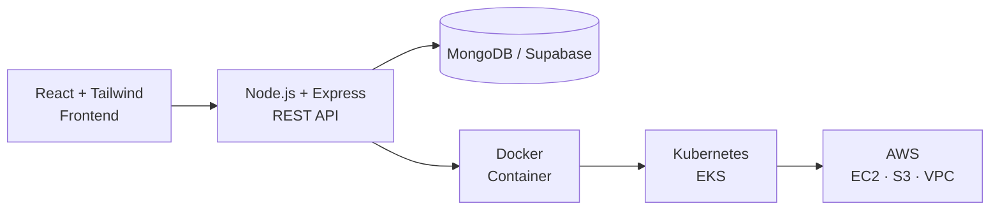

<!-- ===================== HERO ===================== -->
<div align="center">

<h1>Atinshay Awasthi</h1>
<h3>Software Engineer &nbsp;•&nbsp; Full Stack (MERN) &nbsp;•&nbsp; DevOps &amp; Cloud</h3>

<a href="https://git.io/typing-svg">
  
</a>

<br/><br/>

<a href="https://www.linkedin.com/in/atinshay-awasthi"></a>
<a href="mailto:atinshayawasthi@gmail.com"></a>
<a href="https://github.com/AtinshayAwasthi?tab=repositories"></a>


</div>

---

<!-- ===================== SNAPSHOT ===================== -->
<div align="center">
<table>
  <tr>
    <td align="center" width="25%"><h2>🎓</h2><b>GATE 2026</b><br/>CS Qualified</td>
    <td align="center" width="25%"><h2>🧩</h2><b>150+</b><br/>DSA Problems Solved</td>
    <td align="center" width="25%"><h2>🏆</h2><b>10+</b><br/>Hackathons</td>
    <td align="center" width="25%"><h2>💼</h2><b>2</b><br/>Internships</td>
  </tr>
</table>
</div>

<!-- ===================== ABOUT ===================== -->
## 👨‍💻 About Me

I'm a software engineer who likes taking an idea from a blank editor to a **deployed, working product**. I build full-stack apps with **React, Node.js and MongoDB**, and I ship them using **Docker, Kubernetes and AWS**. I've done internships in both **full-stack development** and **DevOps**, so I'm comfortable on both sides of the code-to-production path.

```json
{
  "name":      "Atinshay Awasthi",
  "education": "B.E. CSE (DevOps), Chandigarh University, 2026",
  "strengths": ["REST APIs", "Full-stack apps", "Containers & Kubernetes", "AWS", "DSA in C++"],
  "currently": "Exploring cloud-native systems and scalable backend design",
  "open_to":   "Software Engineer / Full Stack / DevOps roles"
}
```

<!-- ===================== TECH STACK ===================== -->
## 🛠️ Tech Stack

<div align="center">

| | |
|:--|:--|
| **Languages** |  |
| **Frontend** |  |
| **Backend** |  |
| **Databases** |  |
| **DevOps & Cloud** |  |
| **Tools** |  |

</div>

<details>
<summary><b>More details: Core CS and AWS services</b></summary>
<br/>

- **Core CS:** Data Structures & Algorithms · OOP · Operating Systems · Computer Networks · SDLC
- **AWS:** EC2 · S3 · IAM · VPC · CloudWatch · EKS
- **Web:** RESTful APIs · JWT authentication · Microservice concepts

</details>

### 🔄 How I Build &amp; Ship



<!-- ===================== PROJECTS ===================== -->
## 🚀 Featured Projects

<table>
<tr>
<td width="50%" valign="top">

### 🔍 FindIt
**Lost & Found Web Platform**

Report, browse and recover lost items in one place.

- RESTful APIs with Node.js, Express.js and MongoDB
- JWT auth with protected routes and encrypted passwords
- Search by category, location, date range and keyword
- Cloudinary image uploads; responsive Tailwind + Shadcn/UI

   

🔗 [**Live Demo**](#) · [**Source Code**](#)

</td>
<td width="50%" valign="top">

### 📍 EffiSphere
**Employee Monitoring Platform**

Attendance and analytics for hybrid and remote teams.

- Automated check-in/out with a 200 m GPS geofence
- Separate admin and employee dashboards with RBAC
- Real-time location tracking and heatmaps
- Built on Supabase for a scalable backend

  

🔗 [**Live Demo**](#) · [**Source Code**](#)

</td>
</tr>
</table>

<!-- ===================== EXPERIENCE ===================== -->
## 💼 Experience

<table>
<tr>
<td width="50%" valign="top">

**DevOps Summer Intern**
Celebal Technologies · *Remote · Jun – Aug 2025*

- Structured DevOps and cloud internship with hands-on labs
- Capstone project on application deployment and automation
- Worked across cloud infrastructure and Linux environments

</td>
<td width="50%" valign="top">

**Full Stack Developer Intern**
Kraf Technologies · *Remote · Apr – Jun 2025*

- Built frontend and backend features for the Krafcool production website
- Followed the SDLC under senior developer guidance
- Debugged issues and improved website performance

</td>
</tr>
</table>

<!-- ===================== EDUCATION ===================== -->
## 🎓 Education &amp; Achievements

- **B.E. in Computer Science Engineering (DevOps)**, Chandigarh University, Punjab · 2022 – 2026
- 🏅 Qualified **GATE 2026 (CS)**
- 🏆 Participated in **10+ hackathons** during college
- 🧠 Solved **150+ DSA problems** on coding platforms

<!-- ===================== STATS ===================== -->
## 📊 GitHub Analytics

<div align="center">


</div>

<!-- ===================== CONNECT ===================== -->
## 🤝 Let's Connect

I'm open to **Software Engineer, Full Stack and DevOps** opportunities. If you have a role, a project, or just want to talk tech, reach out.

<div align="center">

<a href="mailto:atinshayawasthi@gmail.com"></a>
<a href="https://www.linkedin.com/in/atinshay-awasthi"></a>

<br/><br/>

<sub>⭐ If you like my work, feel free to star a repo.</sub>

</div>
